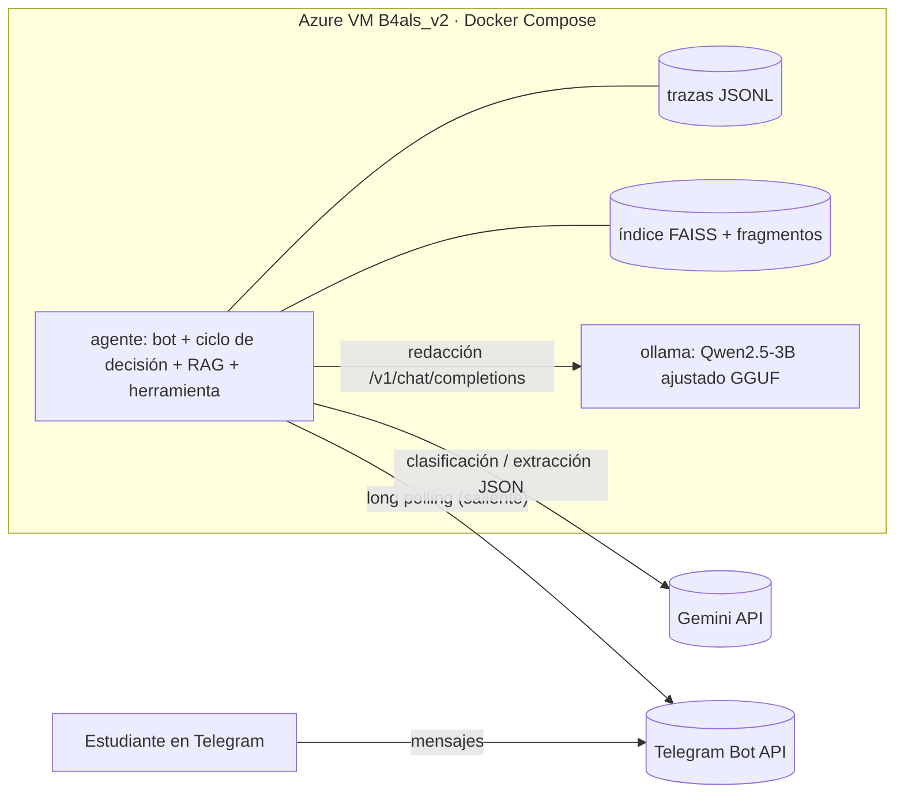
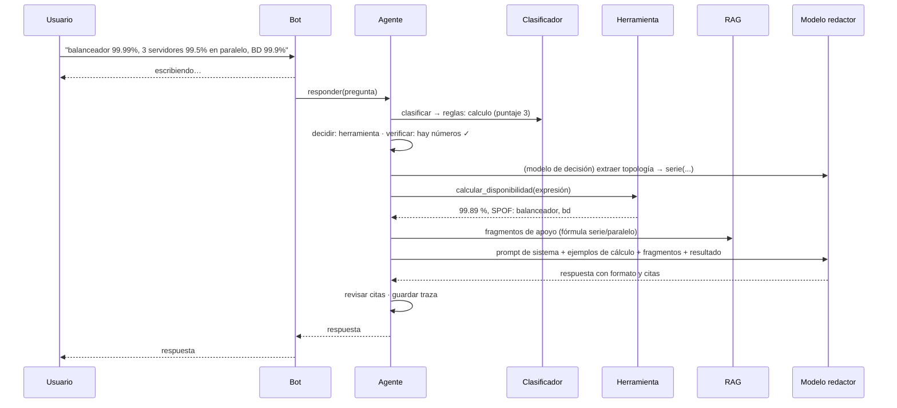

# Arquitectura del agente

## Vista de contexto

## Vista de bloques

| Bloque | Archivo | Responsabilidad |
|---|---|---|
| Canal | `app/bot/telegram_bot.py` | Long polling, acción *typing*, comandos `/fuentes`, `/traza`, `/fewshot` |
| Ciclo de decisión | `app/agent/agente.py` | Clasificar → decidir → verificar → ejecutar → redactar → revisar citas |
| Clasificador | `app/agent/clasificador.py` | Reglas con pesos y, si dudan, modelo por API con JSON |
| Few-shot dinámico | `app/agent/fewshot.py` | Selección de ejemplos por tipo (criterio por defecto) o por similitud |
| Prompts | `app/agent/prompts.py` | Prompt de sistema fijo, instrucciones por tipo, respuestas directas |
| Trazas | `app/agent/trazas.py` | Un JSON por consulta con cada paso, puntajes y latencias |
| RAG | `app/rag/` | Fragmentación por estructura, embeddings, FAISS, citas |
| Herramienta | `app/tools/disponibilidad.py` | Disponibilidad compuesta, nueves, caída, eslabón débil, SPOF |
| Cliente LLM | `app/llm.py` | Un solo cliente para cualquier endpoint compatible con OpenAI |
| Evaluación | `app/evaluacion/rubrica.py`, `scripts/` | Top-k del RAG, separación de datos, comparación A/B |

## Vista de ejecución: una pregunta de cálculo

## Atributos de calidad del propio agente

| Atributo | Táctica |
|---|---|
| Verificabilidad | Toda afirmación de contenido lleva cita `[DOC, §sección]`; se revisa que la cita exista |
| Explicabilidad | Reglas de clasificación y tabla de decisión explícitas; trazas por paso |
| Disponibilidad | `restart: unless-stopped`, healthcheck de Ollama, degradación a reglas si la API cae |
| Seguridad | Secretos en `.env`, contenedor sin root, sin puertos expuestos, `eval` prohibido en la herramienta |
| Rendimiento | Respuestas directas y "sin evidencia" sin llamar al modelo; `OLLAMA_KEEP_ALIVE` evita arranques en frío |
| Modificabilidad | Cliente LLM único: cambiar de proveedor o de modelo es cambiar el `.env` |
